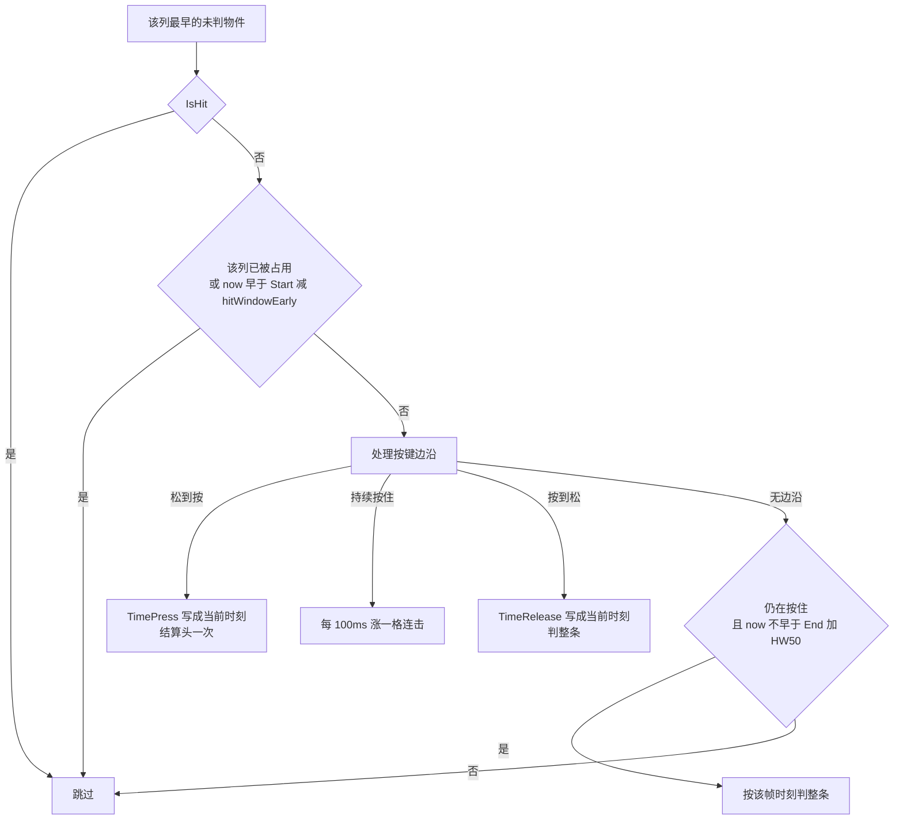
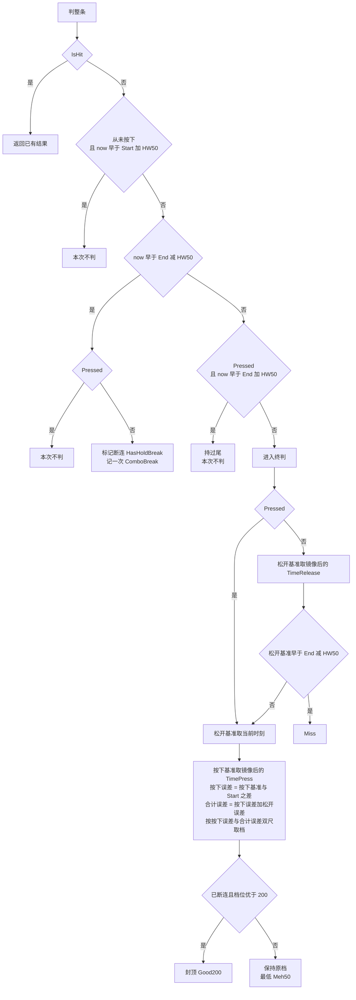
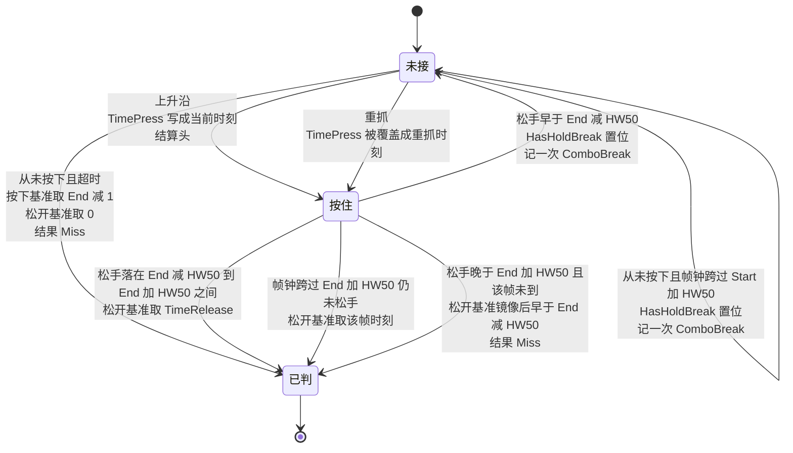

# stable mania 长条（LN）判定机制

`HW50` 指 `HitWindow50`，`hitWindowEarly` 是判「是否还没到位」的提前量。

## 1. 每帧判定

## 2. 判整条 LN

## 3. 状态迁移

## 4. 事件与变量对照

| 事件 | stable 动作 | 关键变量 |
|---|---|---|
| 松 → 按 | 结算头一次，写按下时刻 | `TimePress` 每次按下都覆盖 |
| 持续按住 | 每 100ms 涨一格连击 | 节拍锚点每 100ms 前进一次 |
| 从未按下，帧钟跨过 `Start + HW50` | 立即断连，记一次 ComboBreak；尾不结算，仍可重抓 | `HasHoldBreak` 置位 |
| 按 → 松，早于 `End − HW50` | 断连，记一次 ComboBreak，LN 仍可重抓 | `HasHoldBreak` 置位 |
| 按 → 松，落在 `End − HW50` 到 `End + HW50` 之间 | 判整条 | 松开基准取 `TimeRelease` |
| 一直按住到 `End + HW50` | 帧钟判整条；之后松手不改结果 | 松开基准取该帧时刻 |
| 从未按下 | Miss | 按下基准取 `End − 1`，松开基准取 0 |

## 5. 两个容易误读的点

**头档只算一次，但 `TimePress` 会被反复覆盖。** 按下分支的进入条件是 `!Pressed`，
`TimePress = 帧钟` 没有任何「首次按下」守卫。头的重复结算由单独的「头已命中」标志挡住，
挡不住 `TimePress` 被改写。断连重抓之后，尾判的按下基准已经是重抓时刻。

**封顶是单向下压。** 断连标志只把优于 200 的档位拉下来。
重抓让按下误差变成「重抓 − 头」，先落进 `Meh50`，此时封顶条件不成立，结果停在 50。
